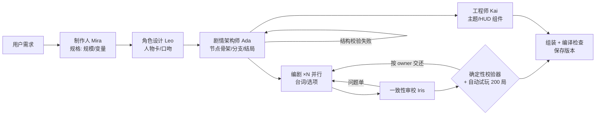

# 剧情工坊 · 多 Agent 剧情游戏生成器

一句话描述想要的剧情游戏，一支 AI agent 团队（制作人、角色设计、剧情架构师、编剧 ×N、一致性审校、前端工程师）协作生成一个**可玩、可分享、源码可改**的 web app；之后可以继续用对话修改、@ 某位成员、回退版本、Remix 别人的作品。

这是一个垂直场景的 Atoms：用"分支剧情游戏"这个可被代码验证的场景，换取生成结果的可靠性。

## 体验路径

1. 首页输入需求（或点题材快捷按钮），进入项目页
2. 左栏看团队协作：每个 agent 的发言、状态；右栏「剧情图」实时生长（灰=骨架、蓝=已写、红=有问题、绿=完成）
3. 完成后在「预览」试玩，「代码」里查看/修改源码并保存为新版本
4. 继续对话修改：「加一个隐藏结局」「让林晚说话更冷淡」「@Kai 换成暖色调」
5. 分享：`/play/<id>` 链接 + 二维码，手机扫码即玩

## 架构



**关键设计**

| 决策 | 做法 | 为什么 |
| --- | --- | --- |
| 结构化交接 | agent 之间只传经 zod 校验的 JSON（规格、角色卡、骨架、编剧稿） | 避免自由对话的"传话失真"；同一份 schema 给 agent 输出、校验器、渲染引擎共用 |
| 先骨架后内容 | 架构师定图结构；编剧的输出 schema 里没有 `next`/`effects`，从机制上改不了结构 | 编剧可以并行写，合并零冲突 |
| 确定性校验 | 对"节点 + 变量值"状态空间做 BFS：引用完整、无死路、所有节点和结局可达、不会困在循环 | 可玩性是图论问题，用代码判定，不让 LLM 给 LLM 打分 |
| 按 owner 修复 | 每条错误带 `owner`，结构问题交还架构师、文本问题只交还对应编剧，最多 2 轮 | 不重跑整条流水线 |
| 同一份引擎 | `template/engine/core.js` 既打包进生成的游戏，也被服务端校验器和自动试玩直接 import | 模拟结果和真实游玩一定一致 |
| 分阶段无状态执行 | 每次 `POST /api/runs/:id/advance` 只执行一个阶段，状态和事件全部落库；条件 UPDATE 实现租约防重 | 适配 Vercel serverless（300s 上限），刷新/关页后可断点续跑 |
| 浏览器端编译 | 生成的 React 项目用 Sandpack 在浏览器里实时编译；服务端用 esbuild 做编译检查，失败先让工程师修一轮，仍失败退回默认组件 | 不需要每局 build/部署；任何情况下都能交付能玩的游戏 |
| 对话修改只重做受影响部分 | 制作人把消息分类（文本 / 结构 / 样式 / 提问），文本修改只重写相关角色的节点，结构修改按节点签名 diff 出改动节点 | 小改动 20–40 秒完成 |

## 技术栈

Next.js 16（App Router）· TypeScript · Tailwind · Vercel AI SDK（结构化输出）· zod · Drizzle ORM · Neon Postgres · Sandpack · React Flow · Vitest + PGlite

## 本地开发

```bash
npm install
cp .env.example .env.local        # 填 DATABASE_URL 和模型 API key
npm run db:migrate
npm run dev
```

不需要任何外部服务的冒烟测试模式（内存 Postgres + 固定输出的 mock 团队）：

```bash
DATABASE_URL=pglite LLM_PROVIDER=fake npm run dev
```

## 测试

```bash
npm test          # 96 个单元/集成测试，数据库用 PGlite，模型用 mock
npm run typecheck
```

覆盖：数据层与租约并发、schema 契约、引擎、校验器 6 类规则（含死循环检测）、自动试玩、生成项目的编译与服务端渲染、agent 重试、完整生成流水线（含骨架修复、文本修复、审校修订、HUD 编译失败兜底、失败重试）、对话修改（文本/结构/样式/审校/提问/@成员）、版本恢复、手动改代码校验、remix、限流、API 处理器。

## 部署（Vercel）

1. 在 Vercel 导入本仓库
2. Storage / Marketplace 添加 Neon，自动注入 `DATABASE_URL`
3. 配置环境变量：`LLM_PROVIDER`、对应的 API key、`IP_SALT`、`ADMIN_TOKEN`（可选限流参数见 `.env.example`）
4. 部署。`vercel-build` 会先执行数据库迁移再构建
5. 把生成好的项目设为首页示例：`curl -X POST https://<域名>/api/projects/<id>/example -H "x-admin-token: $ADMIN_TOKEN"`

## 公开部署的防护

- 按 IP 哈希限流：每天生成 3 次、修改 15 次；另有全站每日上限
- 需求长度上限 500 字；所有模型调用只在服务端
- 每一步失败都会说明是哪个 agent，并提供「重试这一步」

## 目录

```
template/            生成游戏的模板（引擎、播放器、默认 HUD、样式）
src/lib/story/       schema、引擎封装、校验器、自动试玩、骨架合并
src/lib/agents/      团队人设、prompt、结构化调用
src/lib/pipeline/    分阶段执行器、生成与修改入口
src/lib/api/         与框架无关的 API 处理器（可单测）
src/app/             页面与路由
```
